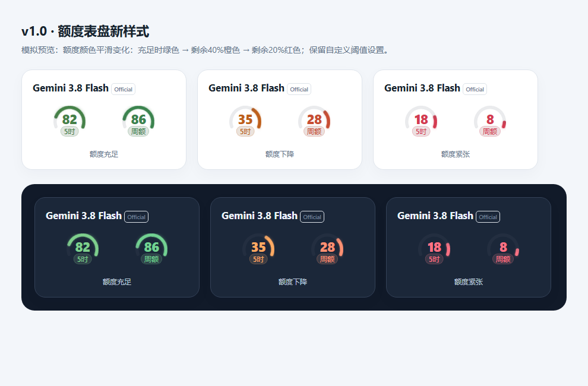

# dsh-usage

[](https://github.com/AAxium/dsh-usage/actions/workflows/ci.yml)


一个面向 **DeepSeek Harness（DSH）** 的模型额度与账户用量插件：在侧栏查看当前模型的余额或订阅余量，并在设置页管理模型监控目标与额度分组。

**基于 [dougen/dsh-deepseek-usage](https://github.com/dougen/dsh-deepseek-usage) 二次开发，非官方独立分支。** 感谢原作者 dougen 和贡献者提供的基础实现。本项目不代表原作者或 DeepSeek 官方，也不宣称全部代码为独立原创。

> **v1.0.2 为维护与加固预览版（Pre-release）**。本分支的版本号与上游版本号不对应。当前发布到 GitHub，**未发布 npm**；不要直接执行 `npm install dsh-usage`，以免安装到同名的其他项目。

## Vibe coding 声明

这是一个 **vibe coding / AI-assisted development** 项目：由 AAxium 提出需求与设计方向，借助 AI 完成代码生成、修改、问题排查、测试及文档整理。

项目复用了上游代码，并在此基础上演进。AI 参与开发及测试不代表代码经过独立人工安全审计；请结合源码、测试和已知边界评估是否适合自己的环境。发现问题欢迎提交 [Issue](https://github.com/AAxium/dsh-usage/issues)。

## 主要功能

- **账户用量**：按当前模型和提供商展示账户余额或订阅剩余额度，具体能力取决于上游接口与宿主服务。
- **模型额度分组**：区分 Gemini 与 Claude/GPT 等额度组，分别处理5小时与周窗口；缺失窗口标记为不可用，不跨组补值。
- **侧栏表盘**：放大的数字、较轻的“5时”“周额”“月额”下标；支持D形、圆环、半圆、紧凑和详细样式。
- **连续配色**：随已用比例从绿到橙再到红平滑混合；默认剩余40%为橙色锚点，剩余20%为红色锚点，可配置阈值。
- **监控设置**：概览与额度组置顶，提供商映射和OAuth设置放在默认折叠的高级设置。
- **监控与模型路由分离**：监控目标不自动等于实际模型路由；提供独立路由查看与管理入口。



*图片由本项目渲染函数生成，使用模拟数字，并非真实账户截图。不同宿主主题和缩放下效果可能不同。*

## 相对上游的调整

本分支在用户提供的候选代码上继续完善，主要涉及：模型额度识别和分组、监控与路由设置、侧栏展开详情、设置页布局、中文标签与渐变配色，以及本次网络请求安全加固。

上游当前公开的0.20.0版本可在 [原项目提交](https://github.com/dougen/dsh-deepseek-usage/commit/87c7e2d30b2a5ea6024e0dff2a10362f50b94813) 查看。该链接用于来源追溯，不表示本分支复用了原仓库全部提交历史。

## 安装与使用

### 环境要求

- 已安装并可正常使用的 DSH / DSH Desktop，具备插件加载能力。
- 开发和本地验证使用 **Node.js 24**；宿主依赖范围见 `package.json`。这些声明不代表每个宿主版本都经过实际测试。
- 查询需要对应提供商的有效凭据，或宿主提供的账户服务。本插件不会生成额度，也不能保证所有反代都有查询接口。

### 从源码或发布包安装

1. 从 [Releases](https://github.com/AAxium/dsh-usage/releases) 获取v1.0源码或压缩包，解压到准备长期保留的目录；也可以克隆本仓库。
2. **先备份DSH配置**。如果已有上游版或旧分支，请先停用旧版，不要同时加载两者。
3. 使用你当前DSH版本提供的本地插件安装方式。已确认本机CLI支持目录和tarball参数，例如：

   ```sh
   dsh plugin --profile desktop add /absolute/path/to/dsh-usage
   ```

   Windows路径含空格时请加引号。Web宿主请将profile改为实际使用的名称。该命令会修改对应profile，不应在没有备份时反复试装。
4. 按宿主提示重新加载插件或重启DSH，在侧栏及用量设置页检查提供商、模型和账户是否正确。

**迁移提示**：包名和浏览器模块ID已改为`dsh-usage`，但内部配置ID `deepseek-usage`、API路径 `/api/deepseek-usage` 及凭据引用保留，以减少兼容变化。旧包引用仍可能需要迁移；保留ID不等于已经验证一键无损迁移。此GitHub发布不会自动更改本机安装。

### 凭据

凭据由DSH服务管理，查询时会发送给对应提供商用于授权。不要将真实令牌、`auth.json`、`.credentials.yaml`、`.env`、运行日志或真实账户截图提交到仓库。高级设置中的手动映射只决定额度适配器，不等同于修改实际模型路由。

## 安全与验证

本次已修复本插件账户/额度查询中的危险IP及映射IPv6绕过、DNS失败放行和二次解析风险，加入流式响应及解压限额，并移除原始异常日志。

| 本地验证（2026-11-08） | 结果 |
|---|---|
| 8个JavaScript文件语法检查 | 通过 |
| 标准`npm test`（含独立真实本机HTTPS验证） | **222项通过，0失败** |
| 发布项目私密文件扫描 | 在本次检查范围内未发现真实凭据或个人配置 |

具体范围见 [安全说明](SECURITY.md) 和 [验证记录](docs/VALIDATION.md)。GitHub上的CI徽章反映后续实际CI运行结果，不代表第三方独立审计。

**兼容变化**：远程HTTP、私网、保留地址、危险或失败的DNS解析会被拒绝；明确的本机回环代理保留。请求使用Node直接传输，不自动继承全局fetch dispatcher或隐式HTTP_PROXY设置。

**安全边界**：本插件能固定自身额度查询的目标地址；DSH宿主执行的模型推理连接由宿主负责，不能据此认为整个DSH都完成了相同防护。

## 已知限制

- 尚未覆盖所有真实账户、提供商返回格式、DSH版本、主题或安装迁移组合。
- 底部DeepSeek模块目前为说明卡片，尚不是完整用量面板的独立迁移。
- Node22及其他平台需以实际CI/用户环境结果为准；目前完整本地测试环境为Windows + Node24。
- 对只有已缓冲`text()`接口的宿主请求对象，插件不能追溯限制宿主此前的内存分配。

## 开发

项目运行依赖由DSH宿主提供，测试通过替身模拟相应服务，无新增第三方运行依赖，也不需要构建浏览器资源。

```sh
npm run check
npm test
npm pack --dry-run --ignore-scripts
```

若本机不允许测试器启动子进程，可逐个文件执行 `node --test --test-isolation=none test/<file>.test.mjs`。这属于替代运行方式，应与标准测试结果分别记录。

提交Issue前请脱敏：提供DSH版本、Node版本、复现步骤、预期与实际行为，以及去除凭据和个人信息后的最小样例。

## 许可与致谢

沿用上游 `package.json` 明示的 **MIT** 许可，许可正文见 [LICENSE](LICENSE)，原项目与本分支的归属说明见 [NOTICE.md](NOTICE.md)。原实现归原作者及贡献者；本分支修改由本分支维护者负责。本项目没有获得原作者或DeepSeek的官方背书。

## English summary

dsh-usage is a non-official, independently maintained derivative of [dougen/dsh-deepseek-usage](https://github.com/dougen/dsh-deepseek-usage), developed through **vibe coding / AI-assisted development** under AAxium's direction. It provides sidebar balance/quota gauges, model quota grouping, reorganized settings and hardened quota-query networking.

**v1.0.2 is a maintenance and hardening preview release**, with 222 local automated tests passing. This is not an independent security audit or a guarantee for all DSH hosts/accounts. Host-managed model inference has a separate network boundary. No npm package has been published. Back up existing DSH settings, avoid enabling the upstream and renamed plugin simultaneously, and review SECURITY.md before installing. Licensed under MIT with upstream attribution retained.
